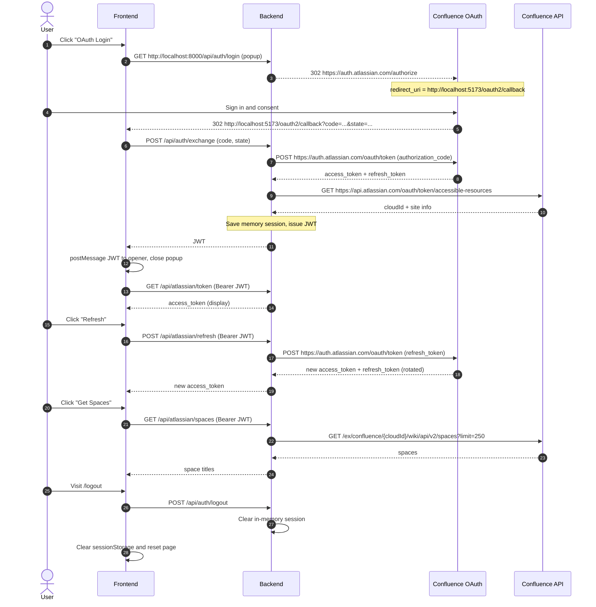

# Atlassian Confluence OAuth Demo

**English** | [简体中文](README.zh-CN.md)

A full-stack demo integrating Atlassian Confluence OAuth 2.0 (3LO) and the Confluence REST API v2.

## Features

- **OAuth Login** button: opens a popup to complete Atlassian authorization.
- After login, displays the Atlassian access token in a text box.
- **Refresh** button: refreshes the access token with the refresh token (the rotated refresh token is saved automatically).
- **Get Spaces** button: lists the titles of Confluence spaces visible to the current user.
- Visiting `/logout` clears the backend in-memory session, the browser JWT, and the page state.

## Tech Stack

- Frontend: TypeScript + React 19 + Vite, Node.js 22.17.0.
- Backend: FastAPI + Python 3.14.6.
- Frontend/backend auth: HS256 JWT (fixed demo user, no user system).
- Atlassian tokens are kept only in backend process memory; no database is used.


## Running the Demo

### Prerequisites

- An Atlassian OAuth 2.0 (3LO) app, <https://developer.atlassian.com/console/myapps/>

### 1. Configure the Atlassian OAuth app

1. Open <https://developer.atlassian.com/console/myapps/> and create an OAuth 2.0 (3LO) app.
2. In **Permissions**, add the granular Confluence scope: `read:space:confluence`.
   - `offline_access` is allowed automatically by Atlassian and is used to obtain a refresh token.
   - Do not mix classic scopes (for example `read:confluence-space.summary`) with granular scopes.
3. In **Authorization**, register the Callback URL. It must match the backend `ATLASSIAN_REDIRECT_URI` **character for character**.
   - This demo redirects to the frontend page: `http://localhost:5173/oauth2/callback`
   - Non-localhost URLs must use **HTTPS**. If you use an external IP, set up an HTTPS reverse proxy or tunnel first.
   - External deployment example: `https://your-host:5173/oauth2/callback`
   - Do not register the backend login entry point `/api/auth/login`; it starts authorization but is not the callback URL.
4. In **Settings**, copy the Client ID and Secret.

### 2. Start the backend

```bash
cd apps/backend
cp .env.example .env
# Edit .env; see the variable reference below.

uv pip install --python .venv/bin/python -r requirements.txt
.venv/bin/uvicorn app.main:app --reload --host 0.0.0.0 --port 8000
```

#### Backend environment variables

| Variable | Description |
|---|---|
| `ATLASSIAN_CLIENT_ID` | Atlassian OAuth app Client ID |
| `ATLASSIAN_CLIENT_SECRET` | Atlassian OAuth app Secret |
| `ATLASSIAN_REDIRECT_URI` | Frontend callback URL registered in the Atlassian console; locally `http://localhost:5173/oauth2/callback`; non-localhost must use HTTPS |
| `ATLASSIAN_SCOPES` | Defaults to `read:space:confluence offline_access` |
| `FRONTEND_URL` | Full browser origin of the frontend, used for CORS and login-error redirects |
| `JWT_SECRET` | Signing key for JWT / OAuth state; use a long random value in production |
| `JWT_EXPIRE_MINUTES` | JWT lifetime in minutes; defaults to 480 |

### 3. Start the frontend

```bash
cd apps/frontend
cp .env.example .env
# Edit .env; see the variable reference below.

npm install
npm run dev -- --host 0.0.0.0
```

#### Frontend environment variables

| Variable | Description |
|---|---|
| `VITE_API_BASE_URL` | Public backend URL used by the browser; no trailing `/` |

### Usage

1. Click **OAuth Login**. The popup opens the backend `http://localhost:8000/api/auth/login` and then redirects to the Atlassian authorization page.
2. After authorization, Atlassian redirects to the frontend page: `http://localhost:5173/oauth2/callback?code=...&state=...`.
3. The frontend callback page calls the backend `POST http://localhost:8000/api/auth/exchange`; the backend exchanges the code for tokens.
4. The callback page passes the JWT to the main window and closes automatically. The page displays the access token and site name.
5. Click **Refresh** to obtain a new access token.
6. Click **Get Spaces**; the text box below lists the space titles.
7. Visit `/logout` or click **Logout** in the top-right corner to clear all login state and return to the initial page.

## Implementation Notes

### Key Flow

Official documentation: https://developer.atlassian.com/cloud/jira/platform/oauth-2-3lo-apps/



### Security Notes

For demo convenience, the Atlassian access token is displayed verbatim in a web page text box, but **production applications must never expose access tokens to the browser**.


### Details

- OAuth authorization URL: `https://auth.atlassian.com/authorize`, with scopes `read:space:confluence offline_access`.
- Callback URL: Atlassian → frontend `http://localhost:5173/oauth2/callback`.
- Code exchange: the frontend callback page posts `code` / `state` to the backend `/api/auth/exchange`; the backend then calls `POST https://auth.atlassian.com/oauth/token`. `client_secret` never leaves the backend.
- Site `cloudId`: `GET https://api.atlassian.com/oauth/token/accessible-resources`; the demo uses the first site.
- List spaces: `GET https://api.atlassian.com/ex/confluence/{cloudId}/wiki/api/v2/spaces?limit=250`.
- Refresh tokens rotate; the backend saves the new refresh token returned by Atlassian after each refresh.
- Access tokens expire after about 1 hour; the demo does not auto-refresh. Use the **Refresh** button.
- The JWT `sub` is fixed to `demo-user`; logout clears the in-memory session, so old JWTs stop working immediately.
- The frontend callback page uses `useRef` to prevent React StrictMode from exchanging the one-time authorization code twice.

### Out of Scope

- Docker packaging and deployment
- Automated tests
- Multi-user / multiple Confluence sites
- Persistent backend sessions
- Automatic access token refresh
- Remote token revocation and space pagination
