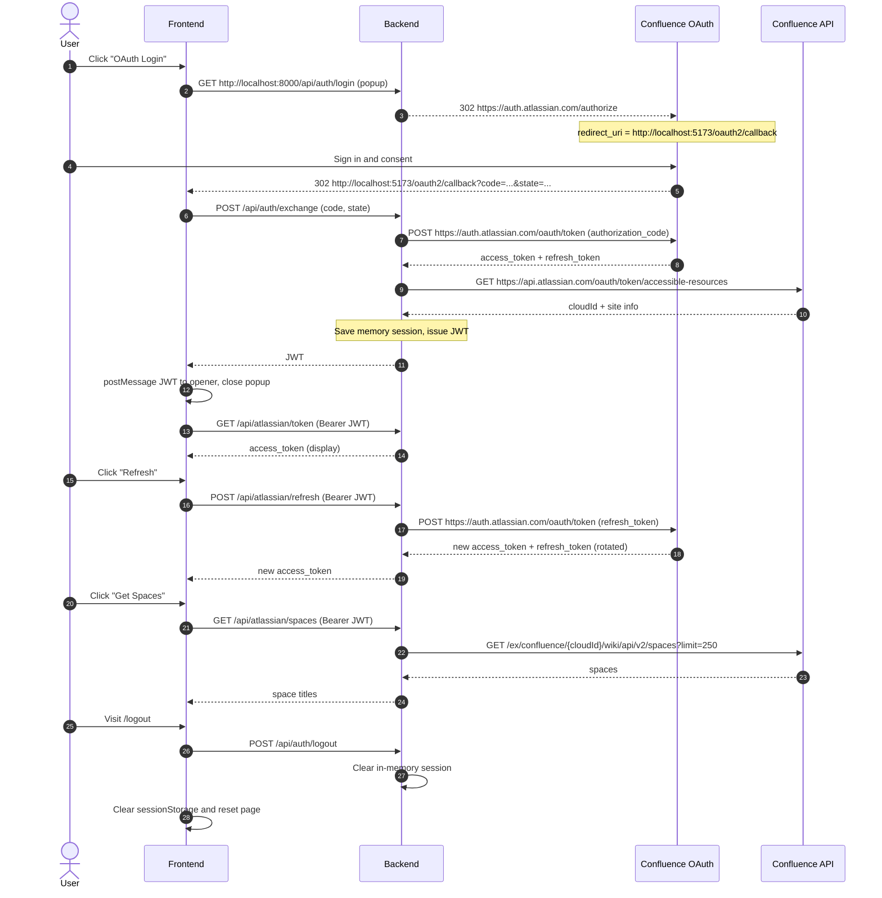

# Atlassian Confluence OAuth Demo

一个前后端分离的 Atlassian Confluence OAuth 2.0 (3LO) + REST API v2 集成 demo。

## 功能

- OAuth Login 按钮：弹窗完成 Atlassian 授权。
- 登录成功后，在页面文本框中显示 Atlassian access token。
- Refresh 按钮：使用 refresh token 刷新 access token（自动保存轮换后的 refresh token）。
- Get Spaces 按钮：获取当前用户可见的 Confluence space 标题列表。
- 访问 `/logout`：清空后端内存会话、浏览器中的 JWT 和页面状态。

## 技术栈

- 前端：TypeScript + React 19 + Vite，Node.js 22.17.0。
- 后端：FastAPI + Python 3.14.6。
- 前后端鉴权：HS256 JWT（固定 demo 用户，无用户体系）。
- Atlassian token 仅保存在后端进程内存中，不使用数据库。


## 运行指引

### 前置条件

- 一个 Atlassian OAuth 2.0 (3LO) 应用，<https://developer.atlassian.com/console/myapps/>

### 1. 配置 Atlassian OAuth 应用

1. 打开 <https://developer.atlassian.com/console/myapps/>，创建一个 OAuth 2.0 (3LO) 应用。
2. 在 **Permissions** 中为 Confluence 添加细粒度 scope：`read:space:confluence`。
   - `offline_access` 由 Atlassian 自动允许，用于获取 refresh token。
   - 不要混用 classic scope（例如 `read:confluence-space.summary`）和细粒度 scope。
3. 在 **Authorization** 中登记 Callback URL，必须与后端 `ATLASSIAN_REDIRECT_URI` **逐字符一致**。
   - 本 demo 的回调落在前端页面：`http://localhost:5173/oauth2/callback`
   - 非 localhost 地址必须是 **HTTPS**。如果使用外部 IP，需要先准备 HTTPS 反向代理或隧道。
   - 外部部署示例：`https://your-host:5173/oauth2/callback`
   - 不要登记后端登录入口 `/api/auth/login`，它是发起授权的地址，不是回调地址。
4. 在 **Settings** 中获取 Client ID 和 Secret。

### 2. 启动后端

```bash
cd apps/backend
cp .env.example .env
# 编辑 .env，参考后文说明

uv pip install --python .venv/bin/python -r requirements.txt
.venv/bin/uvicorn app.main:app --reload --host 0.0.0.0 --port 8000
```

#### 后端环境变量

| 变量 | 说明 |
|---|---|
| `ATLASSIAN_CLIENT_ID` | Atlassian OAuth 应用 Client ID |
| `ATLASSIAN_CLIENT_SECRET` | Atlassian OAuth 应用 Secret |
| `ATLASSIAN_REDIRECT_URI` | 与 Atlassian 后台登记完全一致的前端回调地址；本地为 `http://localhost:5173/oauth2/callback`，非 localhost 必须 HTTPS |
| `ATLASSIAN_SCOPES` | 默认 `read:space:confluence offline_access` |
| `FRONTEND_URL` | 前端浏览器访问的完整 origin，用于 CORS 和登录失败时的跳转 |
| `JWT_SECRET` | JWT / OAuth state 签名密钥，生产环境必须使用长随机值 |
| `JWT_EXPIRE_MINUTES` | JWT 有效期，默认 480 分钟 |

### 3. 启动前端

```bash
cd apps/frontend
cp .env.example .env
# 编辑 .env，参考后文说明

npm install
npm run dev -- --host 0.0.0.0
```

#### 前端环境变量

| 变量 | 说明 |
|---|---|
| `VITE_API_BASE_URL` | 是浏览器访问后端的公开地址，不要带结尾 `/` |

### 使用流程

1. 点击 **OAuth Login**，弹窗打开后端 `http://localhost:8000/api/auth/login`，再跳转到 Atlassian 授权页。
2. Atlassian 授权完成后回调前端页面：`http://localhost:5173/oauth2/callback?code=...&state=...`。
3. 前端回调页调用后端 `POST http://localhost:8000/api/auth/exchange`，由后端完成 code 换 token。
4. 回调页把 JWT 交给主窗口并自动关闭，页面显示 access token 和站点名称。
5. 点击 **Refresh** 获取新的 access token。
6. 点击 **Get Spaces**，下方文本框显示 space 标题列表。
7. 访问 `/logout` 或点击右上角 **Logout**，清空所有登录状态并回到初始页面。

## 实现说明

### 关键过程

官方文档：https://developer.atlassian.com/cloud/jira/platform/oauth-2-3lo-apps/



### 安全说明

为了 demo 便利，Atlassian access token 会原样显示在网页文本框中，但**生产环境绝不应把 access token 暴露给浏览器**。


### 杂项

- OAuth 授权 URL：`https://auth.atlassian.com/authorize`，scope 为 `read:space:confluence offline_access`。
- 回调地址：Atlassian → 前端 `http://localhost:5173/oauth2/callback`。
- code 换 token：前端回调页把 `code` / `state` POST 到后端 `/api/auth/exchange`，后端再调用 `POST https://auth.atlassian.com/oauth/token`。`client_secret` 始终只保存在后端。
- 站点 `cloudId`：`GET https://api.atlassian.com/oauth/token/accessible-resources`，demo 取第一个站点。
- 列 space：`GET https://api.atlassian.com/ex/confluence/{cloudId}/wiki/api/v2/spaces?limit=250`。
- refresh token 会轮换，刷新后后端保存 Atlassian 返回的新 refresh token。
- access token 约 1 小时后过期；demo 不做自动刷新，由用户点击 **Refresh**。
- JWT 的 `sub` 固定为 `demo-user`；登出会清空内存 session，因此旧 JWT 也会立即失效。
- 前端回调页使用 `useRef` 防止 React StrictMode 重复兑换一次性 authorization code。

### 当前范围以外

- Docker 打包与部署
- 自动化测试
- 多用户 / 多 Confluence 站点选择
- 后端持久化会话
- access token 自动刷新
- 远端 token 吊销与 space 分页
